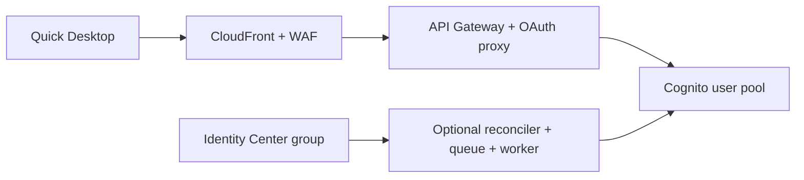

# Amazon Quick Desktop authentication with Amazon Cognito

Use Amazon Cognito as the identity provider for **enterprise sign-in to Amazon
Quick Desktop**. This AWS CDK sample creates the Cognito user pool and the OAuth
proxy needed to connect it to an existing Amazon Quick Enterprise account.
Optionally, provision Cognito users from an IAM Identity Center group.

**Start here — step-by-step setup guide with screenshots:**
[English](docs/SETUP.md) · [한국어](docs/SETUP.ko.md)

The guide takes you from choosing a deployment mode through configuring Quick,
registering a user, and verifying a successful Desktop sign-in and chat.

This sample is for learning and evaluation in non-production environments.
Review security, operations, and end-to-end behavior before adapting it for
production.

## What this repository does

- Deploys a Cognito user pool and public OAuth client with native Desktop callbacks.
- Places an OAuth proxy behind API Gateway, CloudFront, and AWS WAF. The proxy
  removes the unsupported `offline_access` scope while preserving the other
  OAuth/PKCE parameters and token response bodies.
- Outputs the five values needed for Quick's extension access configuration.
- Optionally provisions and disables Cognito users according to Identity Center
  group membership, using initial import, periodic reconciliation, and event updates.

Quick maps the Cognito email claim to an existing Quick user. The stack creates
authentication infrastructure; **Quick subscriptions, user roles, extension
access, and the Desktop extension are configured separately** in the setup guide.

## Choose how to manage users

| Mode | Use it when | Cognito users |
| --- | --- | --- |
| **Cognito-only** | You want the simplest setup or will manage a small user list yourself | Created by an administrator in Cognito |
| **Identity Center provisioning** | You already manage users in an Identity Center group | Created and reconciled automatically from the selected group |

The CDK application defaults to Identity Center provisioning. The setup guide
sets the mode explicitly on every CDK command, including bootstrap.

Identity Center mode copies user identity attributes and group membership; users
set a **separate Cognito password and authenticator-app MFA**. It does not federate
Identity Center sign-in or copy its passwords, MFA settings, or account-disabled
state. See [access removal](docs/CONFIGURATION.md#access-removal).

If your organization already has a supported enterprise IdP, such as Entra ID,
Okta, Google Workspace, or Ping Identity, review the
[standard Quick enterprise setup](https://docs.aws.amazon.com/quick/latest/userguide/desktop-enterprise-setup.html)
before adding Cognito.

## Before you begin

You need an active Quick **Enterprise** account in a supported home Region, a
Quick administrator, an active Quick user for testing, and AWS deployment
credentials. The deployment commands run in Bash, including AWS CloudShell,
with Git, AWS CLI v2, and Node.js 22 or later.

The guide explains which account and Region to select, how to bootstrap the
required Regions, and which values to copy into each Quick field. Existing
Quick accounts can be used; creating a new subscription is not part of this stack.

## Documentation

| Document | Purpose |
| --- | --- |
| Setup guide: [English](docs/SETUP.md) · [한국어](docs/SETUP.ko.md) | Deployment, illustrated Quick configuration, user provisioning, first sign-in, and acceptance checks |
| [Configuration and operations](docs/CONFIGURATION.md) | All context options, region constraints, user lifecycle, upgrades, security controls, local tests, and cleanup |
| [Troubleshooting](TROUBLESHOOTING.md) | Diagnose deployment, provisioning, and Desktop sign-in failures |
| [Contributing](CONTRIBUTING.md) | Development and contribution process |
| [Security](SECURITY.md) | Report a vulnerability privately |

Defaults include required TOTP MFA, disabled self-sign-up, retained Cognito user
pools, encrypted provisioning queues, origin verification, and no caching of
OAuth responses. Review the [security and operations reference](docs/CONFIGURATION.md#security-and-operations).
AWS resources created by the sample incur charges; review the services and
cleanup steps before deploying.

## License

MIT No Attribution (MIT-0). See [LICENSE](LICENSE).
