# Set up Cognito and Amazon Quick Desktop

Language: **English** · [한국어](SETUP.ko.md)

[Repository overview](../README.md) · [Configuration reference](CONFIGURATION.md) · [Troubleshooting](../TROUBLESHOOTING.md)

Follow this guide to deploy the authentication stack, connect it to Amazon Quick,
and verify a user's first Desktop sign-in. Complete the administrator steps once;
then repeat the user registration and sign-in steps for additional users.

The examples use **Bash**, AWS Region `us-east-1`, and a group named `QuickUsers`
when Identity Center provisioning is selected. Change the Region and group to
match your environment. These are sample settings, not requirements to replace
an existing Quick account or directory.

Screenshots are adapted from the author's [original Korean setup guide](https://madebybk.notion.site/amazon-quick-desktop-enterprise-idp-cognito-idc).
They illustrate the console controls; use **your own deployment outputs** for
all endpoint and client values. Some screenshots show **Create extension** where
the current documentation says **Add extension**. Account details have been masked
or cropped. See [screenshot sources](images/README.md).

## Steps

1. [Confirm the Quick account and permissions](#1-confirm-the-quick-account-and-permissions).
2. [Choose user management and prepare the terminal](#2-choose-user-management-and-prepare-the-terminal).
3. [Deploy both CDK stacks](#3-deploy-both-cdk-stacks).
4. [Add extension access in Quick](#4-add-extension-access-in-quick).
5. [Create and activate the Desktop extension](#5-create-and-activate-the-desktop-extension).
6. [Register a user in Quick and Cognito](#6-register-a-user-in-quick-and-cognito).
7. [Install Desktop and complete the first sign-in](#7-install-desktop-and-complete-the-first-sign-in).
8. [Verify the integration and hand it over](#8-verify-the-integration-and-hand-it-over).
9. [Clean up a test deployment](#9-clean-up-a-test-deployment).

## 1. Confirm the Quick account and permissions

Have the following ready before deploying.

| Item | What to check |
| --- | --- |
| Quick subscription | An active **Amazon Quick Enterprise** account. Free/Plus sign-in is a different path. |
| Quick home Region | It supports the full Quick feature set, including Desktop. Check the [AWS Region availability table](https://docs.aws.amazon.com/quick/latest/userguide/regions.html#regions-qs). A Region supporting only Quick Sight is insufficient. |
| Quick administrator | You can open **Manage account**, configure **Permissions → Extension access**, and create an extension. |
| First test user | An active user who can sign in to this Quick account on the web. Record their exact email address, including case. |
| AWS deployment permissions | Credentials in the intended AWS account that can bootstrap CDK and create the stack's IAM roles, Cognito, Lambda, API Gateway, CloudFront, WAF, Secrets Manager, and logging resources. Identity Center mode also needs the directory, queue, event, and optional CloudTrail permissions in the templates. Have your AWS administrator review the synthesized permissions. |
| User device | A supported macOS or Windows device, access to the user's invitation mailbox, and an authenticator app for Cognito TOTP MFA. See [Desktop system requirements](https://docs.aws.amazon.com/quick/latest/userguide/getting-started-desktop.html#desktop-prerequisites). |
| Network | The device/browser can reach Quick and Cognito, the stack's CloudFront domain, and the local OAuth callback. Use the [official network allowlist](https://docs.aws.amazon.com/quick/latest/userguide/desktop-security.html#desktop-network-access) with your IT team. |

If you already use Quick, keep that subscription and its current sign-in method.
Quick supports Identity Center, IAM federation, and native Quick users for
Desktop enterprise sign-in. **The stack's `useIdc` setting controls Cognito
provisioning; it does not change the Quick account's identity type.**

If you do not have Quick Enterprise, an administrator must create the subscription
and provision the first Quick administrator/user before continuing. Open
**Amazon Quick** from the AWS Management Console and complete its account setup
using your organization's identity and subscription settings. This CDK stack
does not create the subscription or assign Quick users.

If the new Quick account will use Identity Center, prepare the instance, users,
and administrator group in step 2.1 **before** creating the Quick subscription,
then select that instance during signup. Quick's authentication method cannot be
changed after account creation. See [Quick with Identity Center](https://docs.aws.amazon.com/quick/latest/userguide/setting-up-sso.html).

Sign in to the **Quick web application as a Quick administrator**. An AWS IAM
console session alone may show only restricted administration sections. If the
banner below appears, choose **Quick Sign In** and complete Quick sign-in.

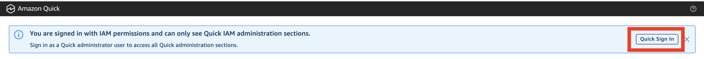

**Checkpoint:** the administrator can open the Quick application, and the test
user can sign in to the intended Quick account on the web.

## 2. Choose user management and prepare the terminal

### 2.1 Choose one mode

| Mode | Choose this when | Preparation |
| --- | --- | --- |
| **A — Cognito-only** | You want the simplest path and will create Cognito users manually | No Identity Center directory or sync group is required by the stack. |
| **B — Identity Center provisioning** | An existing Identity Center group should control the Cognito user list | Prepare the group and deploy in that instance's primary Region. |

For **mode B**, open IAM Identity Center in the intended AWS account and Region.

1. Use the directory instance your organization already manages. If none exists,
   have your identity administrator enable the appropriate instance first.
   For an isolated trial in a single AWS account, Quick supports an
   [account instance](https://docs.aws.amazon.com/singlesignon/latest/userguide/account-instances-identity-center.html)
   where account-instance creation is permitted. The sample can use either an
   account or organization instance visible to its deployment credentials.
2. In **Groups**, create or select a group, for example `QuickUsers`.
3. Add the test user to that group. Their Identity Center email must exactly
   match their active Quick email.
4. Record the group's display name and the instance's primary Region. If several
   instances are visible, also record the intended instance ARN.

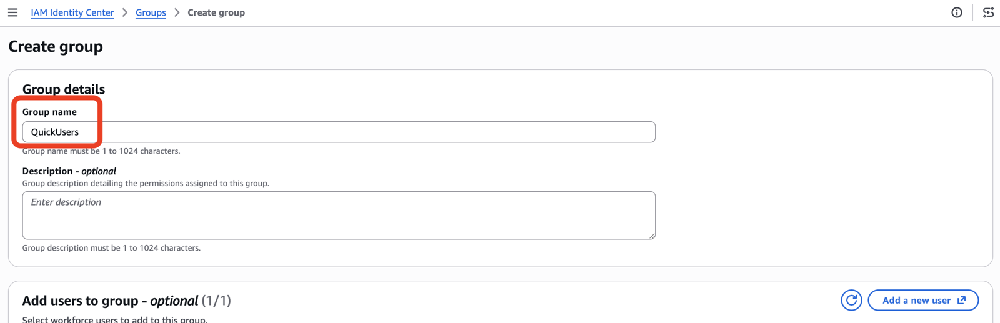

The stack can create a missing group, but it does not create Identity Center
users or add members to that group. It imports existing members after deployment.
Adding someone to the sync group alone does not grant a Quick subscription or
role; their Quick access must also be provisioned.

In the AWS access portal, open **Applications** and select the Quick account.
An account instance can show no entries under **Accounts**; it does not provide
AWS account permission sets.

### 2.2 Open a Bash terminal

You can use **AWS CloudShell** from the AWS console's bottom toolbar. CloudShell
uses the signed-in AWS session. Alternatively, use a local Bash terminal with
AWS CLI credentials already configured for the intended account.

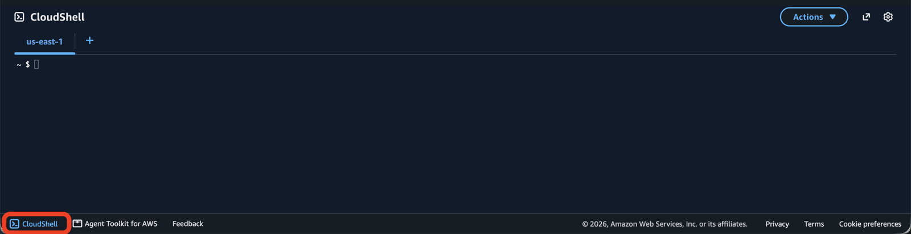

Run:

```bash
aws --version
git --version
node --version
npm --version
aws sts get-caller-identity --query '{Account:Account,Arn:Arn}' --output table
```

Use AWS CLI v2 and **Node.js 22 or later**. If a tool is missing or Node is older,
install a supported version before continuing. Local Python is needed only for
the optional [developer tests](CONFIGURATION.md#local-validation), not deployment.

Verify the AWS account ID in the last command. Keep using this same terminal
through deployment so the variables and chosen CDK options remain available.

### 2.3 Set the Region and clone the repository

For mode A, the example below uses `us-east-1`. For mode B, change it to the
selected Identity Center instance's **primary Region**. The WAF stack always uses
`us-east-1`, even if the authentication stack uses another Region.

```bash
export AWS_REGION=us-east-1
export AWS_DEFAULT_REGION="$AWS_REGION"
AWS_ACCOUNT_ID=$(aws sts get-caller-identity --query Account --output text)

git clone https://github.com/aws-samples/sample-amazon-quick-desktop-cognito-auth.git
cd sample-amazon-quick-desktop-cognito-auth
npm ci
```

`npm ci` installs the versions in the repository's lockfile. A separate CDK
installation or upgrade is not needed.

### 2.4 Set the CDK options for your chosen mode

Run **one** of these blocks.

**Mode A — Cognito-only:**

```bash
CDK_OPTIONS=(-c useIdc=false)
```

**Mode B — Identity Center provisioning:**

```bash
CDK_OPTIONS=(-c useIdc=true -c idcGroupName=QuickUsers)
```

For mode B, replace `QuickUsers` with your exact group display name. Quote the
whole `idcGroupName=...` argument if it contains spaces. When multiple instances
are visible, append `-c idcInstanceArn=YOUR_INSTANCE_ARN` to this array using the
ARN you recorded.

Check the account's existing API Gateway logging role:

```bash
aws apigateway get-account --region "$AWS_REGION" \
  --query cloudwatchRoleArn --output text
```

If this returns an existing role ARN, confirm with your AWS administrator that it
is suitable for API Gateway logging, then preserve it by running:

```bash
CDK_OPTIONS+=(-c apiGatewayAccountRole=false)
```

If it returns `None`, leave the default so the stack creates the logging role.
If access is denied, have the AWS administrator check this regional setting
before proceeding. In mode B, also check whether an existing management-event
trail should be reused with `-c createTrail=false`; see the
[configuration reference](CONFIGURATION.md#account-and-region-constraints).
Reuse a trail only after confirming it is actively logging the relevant Identity
Center management events in the instance's primary Region.

**Checkpoint:** AWS account, authentication Region, and mode are selected.
All following CDK commands include the same `"${CDK_OPTIONS[@]}"`.
This matters even for bootstrap: the app defaults to requiring an Identity
Center group unless `useIdc=false` is supplied.

## 3. Deploy both CDK stacks

### 3.1 Bootstrap the required Regions

```bash
npx cdk bootstrap "aws://${AWS_ACCOUNT_ID}/${AWS_REGION}" "${CDK_OPTIONS[@]}"

if [ "$AWS_REGION" != "us-east-1" ]; then
  npx cdk bootstrap "aws://${AWS_ACCOUNT_ID}/us-east-1" "${CDK_OPTIONS[@]}"
fi
```

This prepares CDK's deployment resources. An administrator may need to perform
bootstrap if your usual deployment role cannot create those resources.

### 3.2 Review and deploy

```bash
npx cdk synth "${CDK_OPTIONS[@]}"
npx cdk diff "${CDK_OPTIONS[@]}"

mkdir -p .local
npx cdk deploy --all "${CDK_OPTIONS[@]}" \
  --outputs-file .local/deployment-outputs.json
```

Review the proposed resources and IAM changes. Answer the CDK approval prompt
only after reviewing the changes. Wait for deployment to finish; CloudFront can
take several minutes.

With no stack selector, `cdk synth` synthesizes both stacks and `cdk diff`
compares both stacks. Use `--all` with `cdk deploy`.

`--all` deploys both stacks in the right order:

| Stack | Region | Purpose |
| --- | --- | --- |
| `QuickDesktopCognitoIdcStack` | `$AWS_REGION` | Cognito, OAuth proxy, CloudFront, and optional provisioning |
| `QuickDesktopCloudFrontWafStack` | `us-east-1` | CloudFront-scoped WAF |

The stack contains fixed resource names, including a WAF stack in `us-east-1`.
For a first setup, use an account without another installation of this sample.
For an existing deployment, review
the [upgrade and retention notes](CONFIGURATION.md#updating-an-existing-deployment)
before applying changes.

### 3.3 Retrieve and check the outputs

Use the deployment output, `.local/deployment-outputs.json`, or **CloudFormation →
QuickDesktopCognitoIdcStack → Outputs** in the authentication Region.
You can retrieve the same values later with:

```bash
aws cloudformation describe-stacks \
  --region "$AWS_REGION" \
  --stack-name QuickDesktopCognitoIdcStack \
  --query 'Stacks[0].Outputs' \
  --output table
```

Record `PoolId`, `ClientId`, `IssuerUrl`, `AuthEndpoint`, `TokenEndpoint`, and
`JwksUri`. Confirm `CognitoReadiness` is `READY`.

- `IssuerUrl` and `JwksUri` point directly to Cognito.
- `AuthEndpoint` and `TokenEndpoint` point to this deployment's CloudFront proxy.
- `ClientId` is the public Cognito app client ID; there is no client secret to copy.

These different hosts are intentional. Copy the output values exactly instead
of reconstructing URLs from screenshots or substituting the direct Cognito
authorization/token endpoints.

**Checkpoint:** both stacks show `CREATE_COMPLETE` or `UPDATE_COMPLETE`, and
`CognitoReadiness=READY`. This confirms infrastructure/metadata readiness.
Quick sign-in still requires the next steps.

## 4. Add extension access in Quick

This step registers the Cognito client and endpoints with Quick.

1. Open the Quick web application and select the intended Quick account.
2. Open the account/profile menu at the top right and choose **Manage account**.

   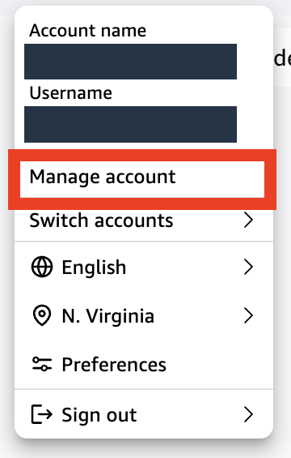

3. Under **Permissions**, choose **Extension access**.

   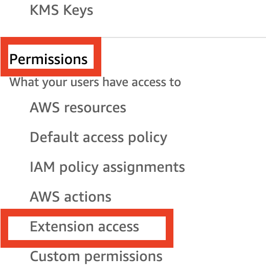

4. Choose **Add extension access**.
5. Select **Amazon Quick (Desktop application for Quick)** and choose **Next**.

   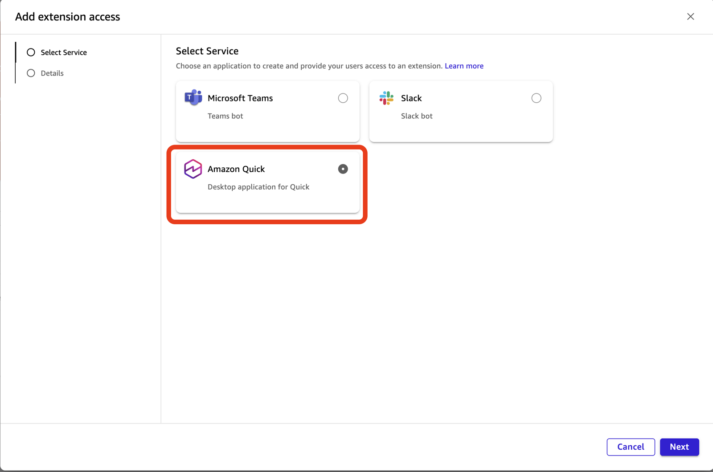

6. Enter the following values:

| Quick field | Enter |
| --- | --- |
| Name | `QuickDesktop-access`, or another name using letters, numbers, and hyphens, with no spaces |
| Description | Optional, for example `Cognito sign-in for Quick Desktop` |
| Issuer URL | Exact `IssuerUrl` output |
| Authorization Endpoint | Exact `AuthEndpoint` output |
| Token Endpoint | Exact `TokenEndpoint` output |
| JWKS URI | Exact `JwksUri` output |
| Client ID | Exact `ClientId` output |

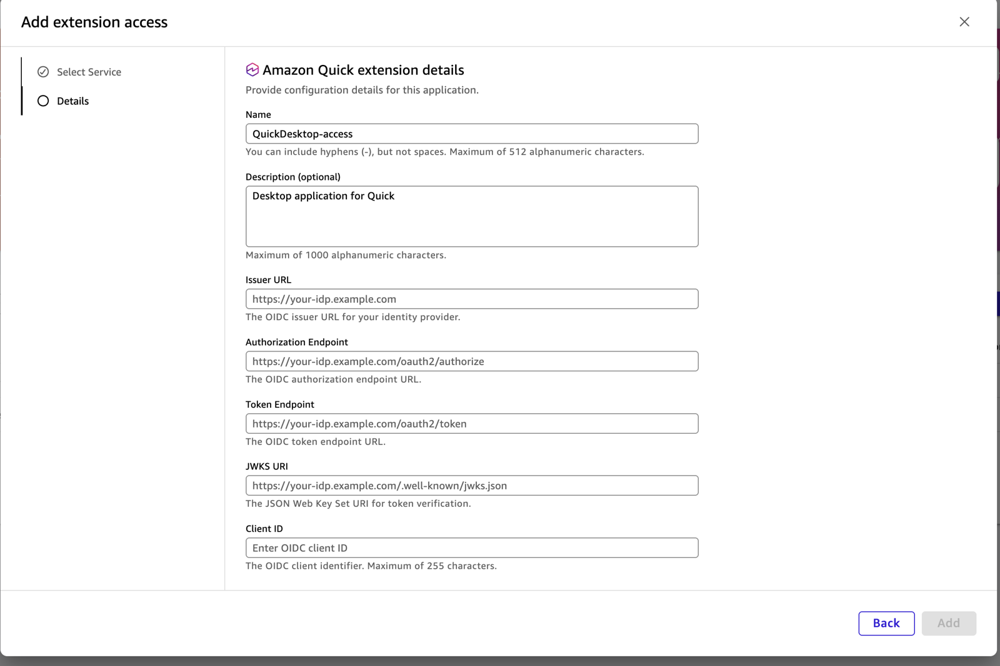

7. Compare **all five client/endpoint fields** with the same stack's outputs.
   Check for accidental whitespace, missing paths, and extra trailing slashes.
8. Choose **Add**. Confirm that your named access appears in the list with type
   **Amazon Quick**.

Extension access values cannot be edited after creation. If a value is wrong,
recreate that access with the correct values. Coordinate changes to an existing
shared integration with its administrator.

**Checkpoint:** `QuickDesktop-access` appears under **Permissions → Extension
access**. Continue to step 5: this entry alone does not enable Desktop sign-in.

## 5. Create and activate the Desktop extension

1. Return to the main Quick application.
2. In the left navigation, choose **Extensions**. Depending on the console
   layout, find it under **More** or **Connect apps and data**.
3. Choose **Add extension** (shown as **Create extension** in the screenshot).

   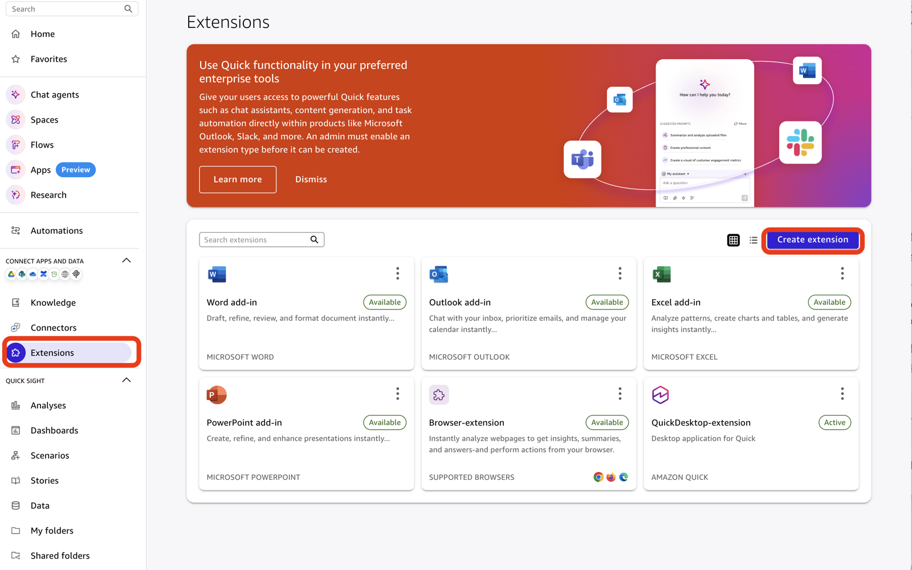

4. Select the **Desktop application for Quick** access created in step 4.
5. Choose **Next**, then **Create**.
6. Confirm the Desktop extension appears and is **Active**.

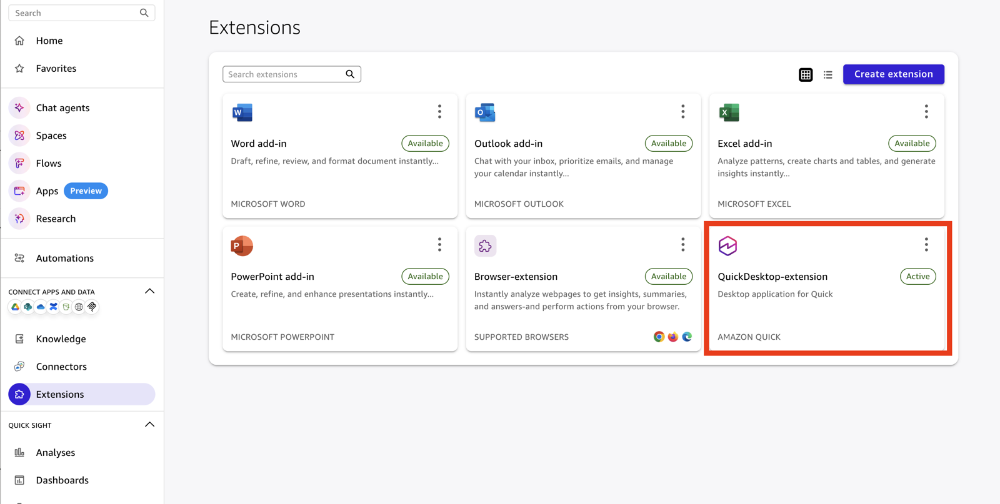

This is an account-level administrator action. Each user does not need to
create a separate extension.

**Checkpoint:** Quick now has both an **extension access** registration and an
**active Desktop extension**. An error saying enterprise sign-in is not configured
usually means the second item is missing or belongs to a different Quick account.

## 6. Register a user in Quick and Cognito

The same person needs an active **Quick identity** and a **Cognito identity**
whose email addresses match exactly, including case.

First confirm that the user can sign in to the intended Quick account on the web.
If necessary, provision them using that account's existing user/group management
process. Confirm their Quick role and subscription allow the features they need.
Cognito provisioning does not assign Quick roles or feature entitlements.

Then use the Cognito registration method matching your deployment mode.

### Mode A — Create a Cognito user manually

1. In the AWS console, open **Amazon Cognito** in `$AWS_REGION`.
2. Open **User pools** and select the pool whose ID matches the `PoolId` output.
   Its display name is `QuickDesktopUserPool`.
3. Open **Users** and choose **Create user**.
4. Use a non-email username, for example `desktop-user-1`. Put the user's exact
   Quick email in the **Email address** field. This pool uses email aliases;
   it does not accept an email-formatted value as the underlying username.
5. After confirming the address belongs to this user in your organization's
   identity records, mark the email as verified. Select email invitation delivery
   and an automatically generated temporary password.
6. Create the user. Confirm they receive **Your Amazon Quick Desktop invitation**.
   Before their first sign-in, their status should be `FORCE_CHANGE_PASSWORD`
   (displayed as requiring a password change in the console).

<details>
<summary>CLI alternative for the same user-creation step</summary>

Use this instead of creating the same user in the console. Replace the example
email with the active Quick user's verified email. Run it from the terminal
configured in step 2.

```bash
POOL_ID=$(aws cloudformation describe-stacks \
  --region "$AWS_REGION" \
  --stack-name QuickDesktopCognitoIdcStack \
  --query "Stacks[0].Outputs[?OutputKey=='PoolId'].OutputValue | [0]" \
  --output text)
QUICK_USER_EMAIL=person@example.com
COGNITO_USERNAME=desktop-user-1

aws cognito-idp admin-create-user \
  --region "$AWS_REGION" \
  --user-pool-id "$POOL_ID" \
  --username "$COGNITO_USERNAME" \
  --user-attributes "Name=email,Value=$QUICK_USER_EMAIL" Name=email_verified,Value=true \
  --desired-delivery-mediums EMAIL \
  --query 'User.{Username:Username,Status:UserStatus,Enabled:Enabled}' \
  --output table
```

Cognito generates and emails the temporary password. This command does not
place a password in shell history. `email_verified=true` is an administrator
assertion: use it only after confirming the user's email ownership.

</details>

### Mode B — Provision from Identity Center

1. In Identity Center, confirm that the user belongs to the exact group selected
   by `idcGroupName`.
2. If the Quick account also uses Identity Center, confirm that the user's
   assignment/group grants the appropriate Quick role in that account.
3. In Cognito, open the pool matching `PoolId` and check **Users**.
4. Allow the initial import or next reconciliation to run. The default schedule
   is every five minutes; work is processed asynchronously.
5. Confirm a Cognito user exists with the same email and that the invitation
   email arrives.

The underlying Cognito username is the Identity Center user ID. The invitation
instructs users to sign in with their **email address**. The stack marks the
directory-provided email verified as an administrator operation.

Identity Center invitations and Cognito invitations are separate. Users set a
new Cognito password even if they already have an Identity Center password.
If provisioning fails, follow [Identity Center troubleshooting](../TROUBLESHOOTING.md#iam-identity-center-provisioning)
instead of manually creating a competing Cognito user with the same email.

**Checkpoint:** the user can sign in to Quick on the web, exists in the correct
Cognito pool with the matching verified email, and has their Cognito invitation.
For missing email, check spam/quarantine and Cognito email delivery settings.

### If the Cognito invitation is missing

Look for **Your Amazon Quick Desktop invitation** at the email stored on the
Cognito user. It contains a separate temporary Cognito password; the Identity
Center activation or password-reset email cannot be used in its place. A sync
log with `action=created` confirms that Cognito accepted user creation, not that
the message reached the inbox. Reconciliation does not repeatedly invite an
existing user.

After checking spam/quarantine and email delivery settings, an administrator can
resend an invitation for a user who has not completed first sign-in. Copy the
**existing Cognito username** from the pool's Users list; in Identity Center mode
it is the directory user ID. Resending generates a new temporary password and
restarts its validity period, so use the latest invitation.

```bash
POOL_ID=$(aws cloudformation describe-stacks \
  --region "$AWS_REGION" \
  --stack-name QuickDesktopCognitoIdcStack \
  --query "Stacks[0].Outputs[?OutputKey=='PoolId'].OutputValue | [0]" \
  --output text)
COGNITO_USERNAME=REPLACE_WITH_EXISTING_COGNITO_USERNAME
COGNITO_STATUS=$(aws cognito-idp admin-get-user \
  --region "$AWS_REGION" --user-pool-id "$POOL_ID" \
  --username "$COGNITO_USERNAME" --query UserStatus --output text)

if [ "$COGNITO_STATUS" = "FORCE_CHANGE_PASSWORD" ]; then
  aws cognito-idp admin-create-user \
    --region "$AWS_REGION" --user-pool-id "$POOL_ID" \
    --username "$COGNITO_USERNAME" \
    --message-action RESEND --desired-delivery-mediums EMAIL \
    --query 'User.{Username:Username,Status:UserStatus}' --output table
else
  echo "No invitation resent. Check the user status; use password recovery after first sign-in."
fi
```

Do not create another user with the same email to recover a missing invitation.

## 7. Install Desktop and complete the first sign-in

### 7.1 Download and install

On Quick's **Extensions** page, open the active Desktop extension's **…** menu
and choose **Download for Mac** or **Download for Windows**.

Official direct downloads are also listed in the
[Desktop installation instructions](https://docs.aws.amazon.com/quick/latest/userguide/getting-started-desktop.html#desktop-download-install):

- [macOS, Apple Silicon — Amazon-Quick.dmg](https://desktop.downloads.quick.aws.com/mac/arm64/Amazon-Quick.dmg)
- [Windows, x64 — Amazon-Quick.exe](https://desktop.downloads.quick.aws.com/windows/x64/Amazon-Quick.exe)

On macOS, open the DMG and drag Amazon Quick into **Applications**. On Windows,
run the installer and follow its prompts. For managed devices, follow your IT
team's software installation policy.

### 7.2 Start enterprise sign-in

1. In the device's default browser, sign in to the intended Quick account **as
   the user being tested**. A stale administrator or different-account session
   can select the wrong integration.
2. Open Amazon Quick Desktop.
3. Select **Dynamic (recommended)**, or explicitly select the **Quick account's
   home Region**.
4. Choose **Continue with SSO**.

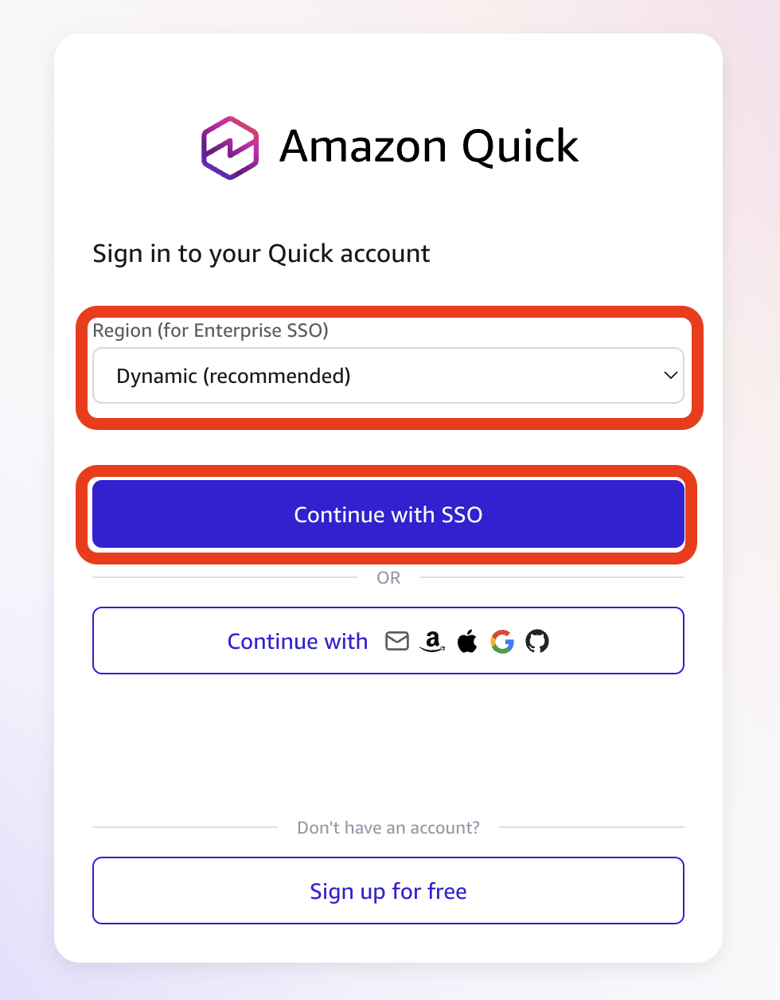

The browser first identifies the Quick account using its web session. If it
asks you to sign in to Quick, do so using that account's normal sign-in method.
It then redirects to the Cognito login page. This initial Quick web sign-in is
expected, even though Cognito handles the subsequent Desktop authentication.

If Quick uses Identity Center, its password and MFA policy apply to this initial
web sign-in. Cognito has its own password and MFA settings. The stack's
`mfaRequired` option controls only Cognito; it does not change Identity Center's
MFA policy. The default requires Cognito TOTP MFA; `mfaRequired=false` makes it
optional.

### 7.3 Complete Cognito password and MFA setup

1. On the Cognito page, enter the user's **email address** and the **temporary
   password from their Cognito invitation**.

   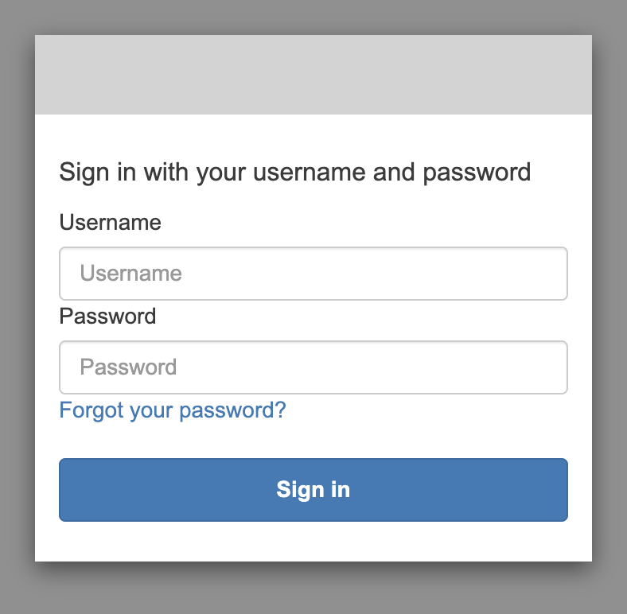

2. When prompted, choose and confirm a new password that meets the displayed
   password policy.

   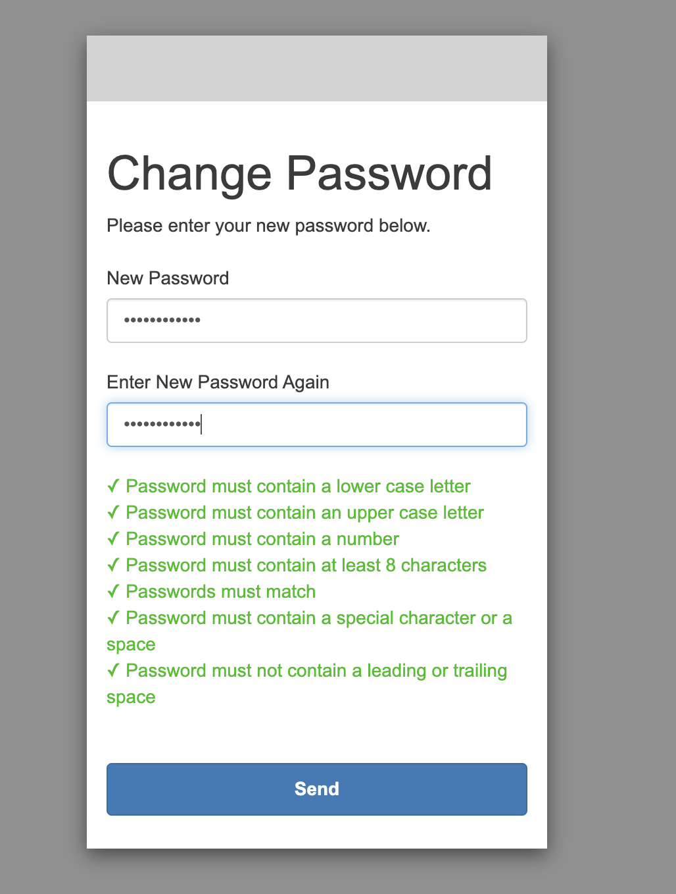

3. With this repository's default configuration, Cognito also requires
   **authenticator-app MFA**. Follow the TOTP setup prompt: add the displayed
   QR code or setup key to the user's authenticator app and enter its current
   six-digit code. Keep the setup key and recovery information private.
4. Complete any remaining prompts, then return to Desktop when the browser
   reports successful sign-in.

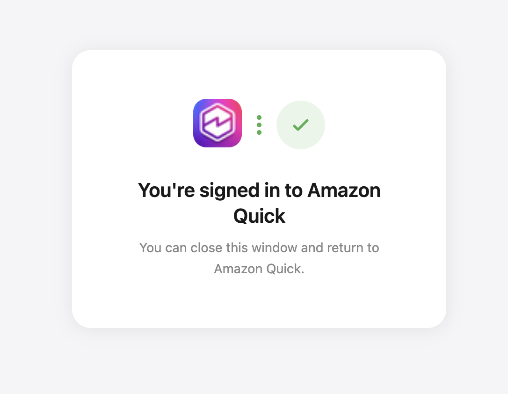

The source screenshots illustrate the password screens; they do not show the
additional MFA step required by this repository's defaults. A returning user
uses their new Cognito password and authenticator code.

### 7.4 Confirm the Desktop session works

Wait for Desktop to load the signed-in home screen. Verify that it is the
intended user/account, then send a simple prompt, such as:

> Write a two-sentence welcome message for our team.

Confirm an answer appears. No file access or connector setup is needed for
this basic sign-in check. Optional first-run connector prompts can be completed
later according to the user's needs.

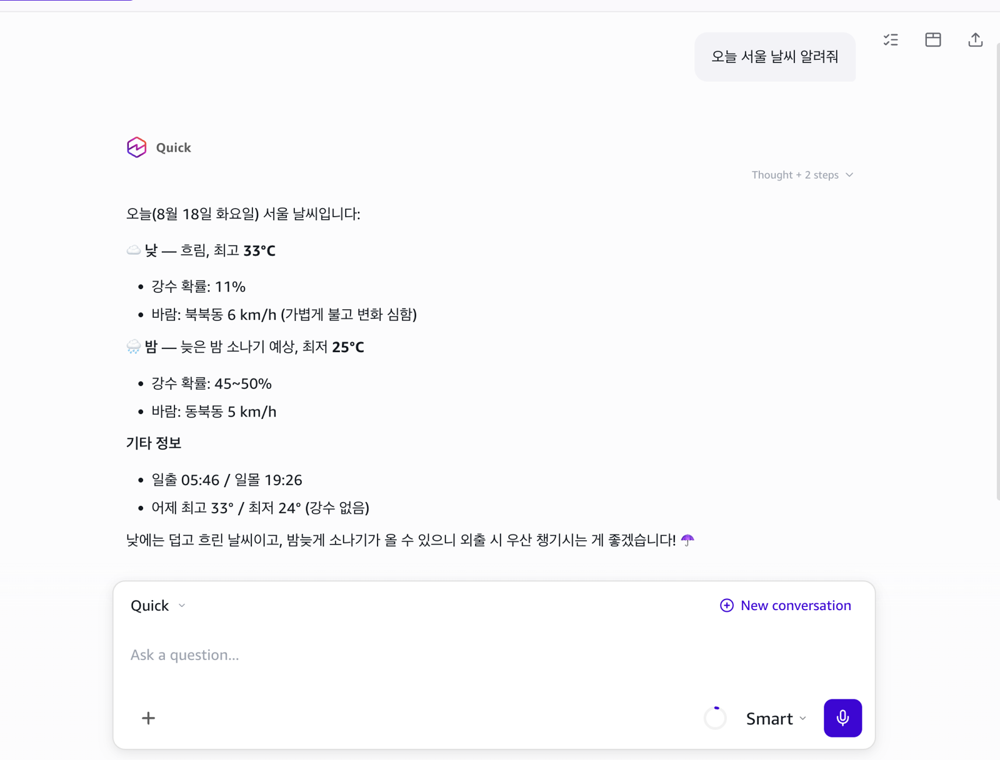

**Checkpoint:** the application has a working signed-in session and can answer
a prompt. A completed CloudFormation deployment, successful Cognito token
exchange, or browser success page alone is not the final acceptance check.

## 8. Verify the integration and hand it over

Before inviting the rest of the users, complete this checklist:

- [ ] Both CloudFormation stacks completed and `CognitoReadiness` is `READY`.
- [ ] All five values in Quick's extension access match the same deployment.
- [ ] The separate Desktop extension is active in the intended Quick account.
- [ ] The first user's Quick and Cognito emails match exactly.
- [ ] The user received the Cognito invitation, changed their password, and
      enrolled in MFA.
- [ ] A fresh Desktop sign-in loads the correct account and a chat receives a reply.
- [ ] For mode B, a test member is provisioned and removing that member disables
      their managed Cognito user after reconciliation. Existing Quick sessions
      and issued tokens have separate lifetimes; see [access removal](CONFIGURATION.md#access-removal).

Give each user the Quick account sign-in instructions, official Desktop download,
the user portion of this guide, and access to their **own** Cognito invitation.
Tell them to have an authenticator app ready. Avoid sharing a common temporary
password or another user's invitation.

Keep the AWS account/Region, deployment revision, selected CDK options, and output
values in your internal operations record. `.local/` is ignored by this repository.
If you reopen the shell, reselect the same credentials, Region, and `CDK_OPTIONS`
before updating or deleting the deployment.

### If a checkpoint fails

| Symptom | Check next |
| --- | --- |
| `idcGroupName is required` during any CDK command | Recreate the mode's `CDK_OPTIONS` array and include it on that command, including bootstrap. |
| CDK says a Region is not bootstrapped | Bootstrap the authentication Region and `us-east-1` with the same AWS account and context. |
| A named resource already exists | Check for an older stack or retained resource; use the upgrade/cleanup reference before creating another stack. |
| `ListInstances` fails or no matching instance is visible | For mode B, verify deployment account, permissions, primary Region, and optional instance ARN. |
| Cannot find Extension access or create an extension | Sign in as a Quick administrator, using **Quick Sign In** if currently in the IAM-only console. |
| Enterprise sign-in is not configured | Confirm the **active extension**, not just extension access, and the browser's selected Quick account. |
| User not found | Confirm the active Quick user and exact, case-sensitive email match in Cognito. |
| `redirect_mismatch` | Check the deployed `QuickDesktopAppClient` callbacks. This stack configures `http://localhost:18080` and `http://127.0.0.1:18080`; no trailing slash is added. |
| Invitation missing or temporary password expired | Check email delivery/quarantine and have the Cognito administrator resend the invitation for a user who has not completed first sign-in. |
| MFA prompt appears | This is expected: TOTP MFA is required by default. Enroll the user's authenticator app. |
| Token/user-info error after Cognito sign-in | Recheck issuer, JWKS, client ID, account selection, and extension activation; use [safe log correlation](../TROUBLESHOOTING.md#correlate-customer-logs-without-collecting-tokens). |

For deeper diagnosis, use [TROUBLESHOOTING.md](../TROUBLESHOOTING.md). It separates
Cognito authentication failures from Quick's later validation and avoids
collecting passwords or raw tokens.

## 9. Clean up a test deployment

Only remove resources belonging to the test integration.

1. In Quick, remove the Desktop extension created in step 5.
2. Under **Manage account → Permissions → Extension access**, remove the
   corresponding access from step 4.
3. From the repository directory, with the original credentials, Region, and
   `CDK_OPTIONS` restored, review and run:

   ```bash
   npx cdk destroy --all "${CDK_OPTIONS[@]}"
   ```

By default, Cognito user pools and the optional CloudTrail log bucket are
**retained**. The source Identity Center group is also left in place. These
retained resources may continue to incur charges or conflict with a fresh
deployment. Review them separately; do not delete a shared directory, Quick
subscription, or CDK bootstrap stack as part of this cleanup.

See [cleanup details](CONFIGURATION.md#cleanup) for retained logs and shared
API Gateway settings.

## Sources

- [Original illustrated Korean guide by BK (Byeonghun) Kim](https://madebybk.notion.site/amazon-quick-desktop-enterprise-idp-cognito-idc)
- [AWS: enterprise Desktop setup, identity matching, and account prerequisites](https://docs.aws.amazon.com/quick/latest/userguide/desktop-enterprise-setup.html)
- [AWS: extension access, extension creation, and Desktop download steps](https://docs.aws.amazon.com/quick/latest/userguide/desktop-enterprise-entra-id.html)
- [AWS: Desktop installation and sign-in](https://docs.aws.amazon.com/quick/latest/userguide/getting-started-desktop.html)
- [AWS: enterprise sign-in troubleshooting](https://docs.aws.amazon.com/quick/latest/userguide/desktop-enterprise-setup-troubleshooting.html)

Console instructions checked against the AWS documentation on September 22, 2026.
The linked IdP-specific page documents the shared Quick-side controls; this
sample's CDK stack supplies the Cognito client and endpoints.
